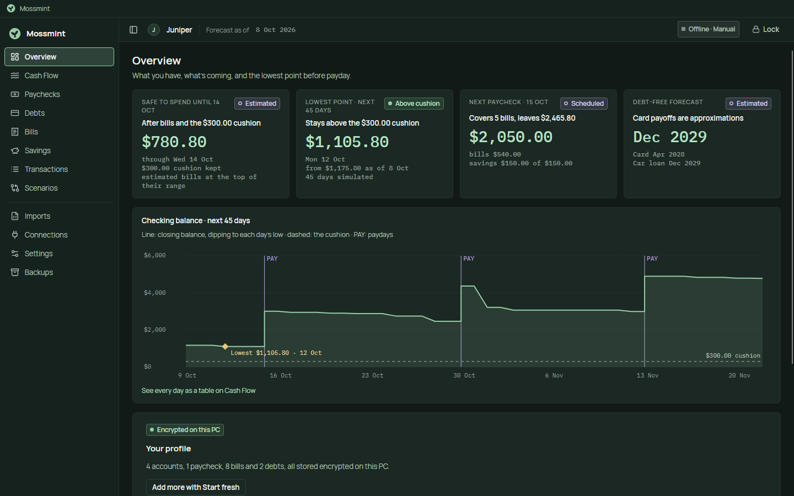
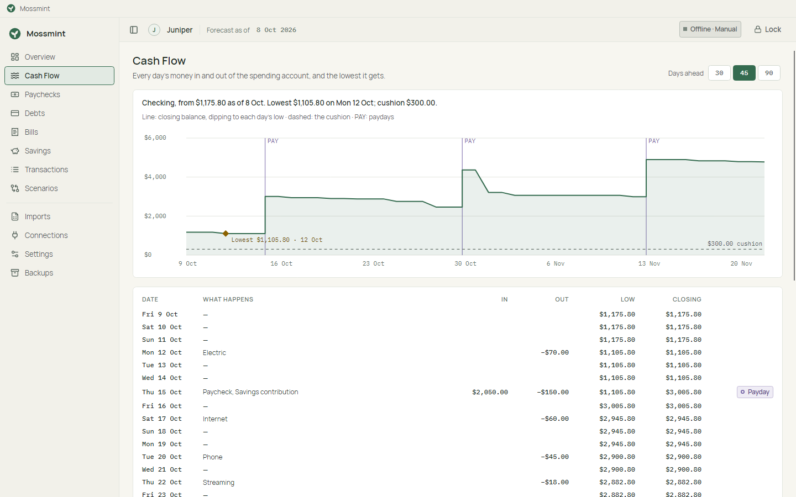

# Mossmint

**Make room to grow.**

Mossmint is a local-first desktop app for paycheck forecasting and debt payoff planning. It tells you what is safe to spend before the next paycheck, which bills each paycheck has to cover, and what an extra debt payment really does to your cash. It works with the network off, it has no account to create, and nothing leaves your computer.

> **Status:** early development; [v0.6.0 is out](https://github.com/hazeliscoding/mossmint/releases/latest) for Windows x64, code-signed. It adds export, an optional daily update check and a sample household to 0.5's debt planning (Scenarios), the dashboard and daily flows, encrypted profiles with verified backups, and read-only workbook import. Bank data (CSV, OFX/QFX, SimpleFIN) comes next, in 0.7. See [ROADMAP.md](ROADMAP.md), and the [user guide](docs/user/guide.md) for a tour of the app.






<sub>Screenshots are rendered headlessly from the synthetic *Juniper* profile; none of it is real financial data.</sub>

## What makes it different

- **It never pretends to know.** Every balance, payment, APR and forecast carries its source and as-of date. A stale balance turns *Safe to spend* into *Needs confirmation*, with the reason, instead of a confident guess.
- **It watches the whole month, not just payday.** The forecast tracks the lowest point between paychecks, so a bill due the day before payday can't hide behind a healthy month-end total.
- **Debt math you can audit.** Daily-interest loans, amortizing loans and credit cards are modelled explicitly, with day-count, rounding and payment-allocation rules written down. If a payment can't overcome interest, you get "never pays off", not a fake date.
- **Your spreadsheets stay yours.** Importing Excel workbooks is read-only and previewed first. Originals are never modified.
- **Offline by default.** No telemetry, no analytics, and Mossmint never asks for your bank login. Update checks are opt-in.

## Privacy contract

- All data stays on this computer, in an encrypted profile database under `%LOCALAPPDATA%\Mossmint`.
- No network calls during normal use. Update checks and future bank connectors are separate, explicit opt-ins. A bank feed such as SimpleFIN is a service you sign up for separately, and it, not Mossmint, holds your bank login.
- No telemetry, crash upload or tracking.
- Logs never contain balances, transaction names, account numbers or file paths.

Details: [PRIVACY.md](PRIVACY.md) and [SECURITY.md](SECURITY.md). How the numbers are computed: [docs/financial-models](docs/financial-models/README.md). How profiles and backups work: [docs/operations](docs/operations/backup-and-restore.md). How workbook import works: [docs/operations/workbook-import.md](docs/operations/workbook-import.md).

## Install

Download `Mossmint-Setup.exe` from the [latest release](https://github.com/hazeliscoding/mossmint/releases/latest). It installs for your Windows account only and needs no administrator rights. `SHA256SUMS` lists every file's checksum. From 0.6.0 the installer and app are code-signed, with Hazel Granados as publisher. Windows SmartScreen may still call a new release unrecognized until downloads build reputation: choose **More info**, check the publisher, then **Run anyway**.

Uninstalling removes the app but never your profiles, which live in `%LOCALAPPDATA%\Mossmint`.

## Build

Requires the .NET 10 SDK on Windows 10 22H2 or later (x64).

```powershell
dotnet restore
dotnet build
dotnet test
dotnet run --project src/Mossmint.Desktop
```

Contributor setup and checks: [CONTRIBUTING.md](CONTRIBUTING.md).

## Releases

1. Set the version in `Directory.Build.props` as `chore(release): x.y.z`, push it to `main`, and wait for CI.
2. Tag that commit and push the tag: `git tag v0.3.0 && git push origin v0.3.0`. Release tags can't be moved or deleted. A tag with a pre-release suffix, such as `v0.4.0-beta.1`, makes a beta on the `win-beta` channel.
3. The [Release workflow](.github/workflows/release.yml) tests and packs Mossmint, launches the portable build, installs with `Setup.exe`, runs the encryption self-check on both, updates an install of the previous release to the new build and checks that a profile and backup made by that release still open, and opens a **draft** GitHub Release with the installer, the portable zip, the Velopack update files and `SHA256SUMS`.
4. Read the draft, write its notes, and publish it.
5. Capture the release's compatibility fixture with `pwsh build/capture-fixture.ps1 -Tag vX.Y.Z` and commit it. Every later build must open it (`CompatibilityTests`).

Running the workflow by hand from the Actions tab builds the same files without publishing anything. `pwsh build/pack.ps1` packs locally.

## License

[MIT](LICENSE). Bundled fonts (Manrope, IBM Plex Mono) are under the SIL Open Font License.
