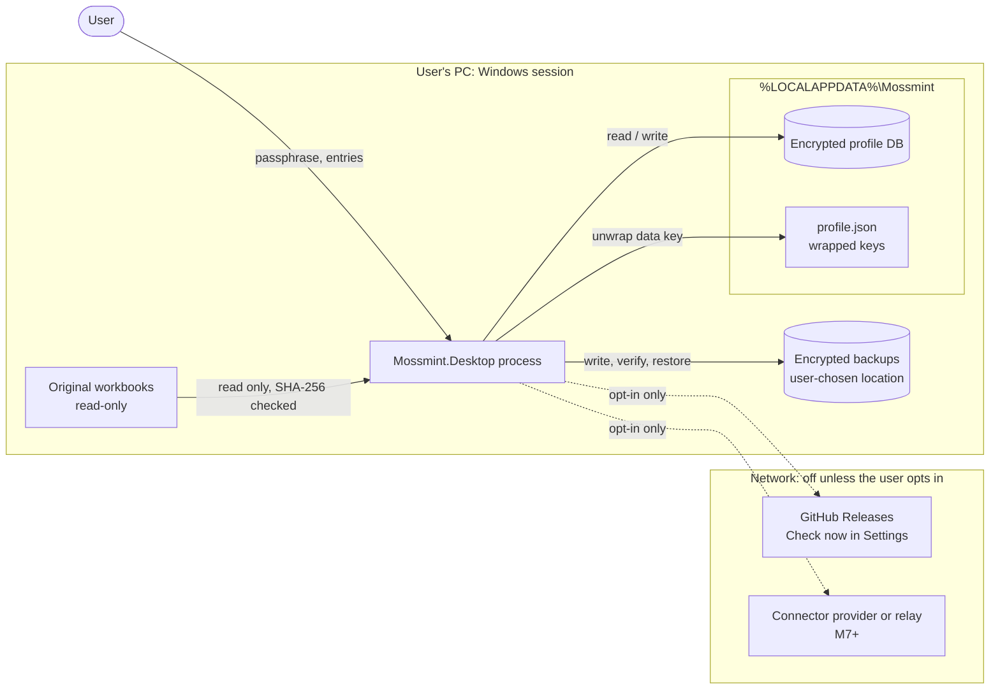
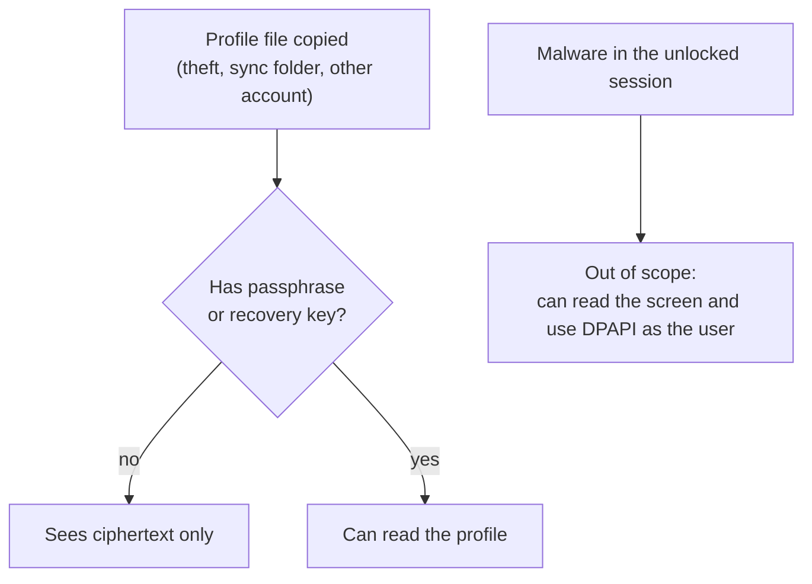

# Threat model (draft)

- **Status:** Draft, updated in M3 (workbook import shipped). Revisit when M6 (releases) lands.
- **Date:** 2026-10-09

## What we protect

| Asset | Why it matters |
|---|---|
| Profile database | Balances, debts, income, transactions: a complete financial picture |
| Key material | The data key, passphrase, recovery key and DPAPI blob unlock everything |
| Backups | Portable copies of the profile, likely stored on USB drives or cloud folders |
| Original workbooks | The user's source of truth; must never be altered |
| Forecast integrity | A wrong "safe to spend" can cause an overdraft or a missed payment |
| Release artifacts | A tampered installer compromises every user |

## Who we defend against

1. **Someone with a copy of the files**: a stolen powered-off laptop, a cloud-sync folder, another Windows account, a discarded drive.
2. **Curious software that reads logs or crash dumps** without targeting Mossmint.
3. **Supply-chain attackers**: a malicious package, a compromised GitHub Action, a tampered release.
4. **Malicious or careless contributors** adding network code, telemetry or real data.
5. **The app itself**: bugs that corrupt data, lose a backup, or report a guess as fact.

## Out of scope

- Malware or an attacker in the user's **unlocked** Windows session. They can read the screen, log keystrokes and use DPAPI as the user. Mossmint limits exposure (locked profiles, no plaintext caches) but can't defend against this.
- Physical attacks on a running, unlocked machine.

## Trust boundaries

Solid arrows stay on the PC. Dotted arrows cross the network boundary, and only after the user turns that feature on.

## Threats and mitigations

| Threat | Mitigation | Where |
|---|---|---|
| Profile file copied and read | SQLCipher v4 page encryption with a random data key, envelope keys, fail-closed open | ADR-0001, done in M2 |
| Weak passphrase brute-forced offline | Argon2id (64 MiB, 3 passes), 12-character minimum; the recovery key carries 160 random bits | ADR-0001, done in M2 |
| Plaintext fallback after a packaging mistake | Open refuses unless sqlite3mc is loaded and the cipher is active; `--verify-encryption` checks the packaged build and CI runs it | ADR-0001, done in M2 |
| Backup restored over the wrong profile | Restore into a new folder, verify, then make it a new profile; nothing is overwritten | ADR-0001, done in M2 |
| Backup tampered with or truncated | Chunked AES-GCM bound to the header, index and final flag; hash, integrity check and row counts before use | done in M2 |
| Old passphrase still works after a change | The passphrase envelope is replaced atomically; no previous copy of `profile.json` is kept | done in M2 |
| Tests or tools touch a real profile | `MOSSMINT_DATA_ROOT` points every test and the screenshot tool at temporary folders | done in M2 |
| Financial data in logs or crash output | No crash upload; redacting logger; no values, paths or tokens logged | AGENTS.md, M2 |
| Network exfiltration by new code | Architecture test rejects networking assemblies; runtime monitor in smoke tests; review rule | M0 |
| Real data committed to the public repo | `.gitignore`, CI private-file guard with positive control, secret scan of full history | M0 |
| Import modifies or corrupts the original workbook | Read-only open, then work on an in-memory copy; SHA-256 before and after; no writes to source paths | done in M3 |
| Failed import leaves a half-written profile | Encrypted snapshot, then one transaction; a preview overtaken by another import is refused | done in M3 |
| Interrupted upgrade leaves a half-migrated profile | A marker names the pre-upgrade snapshot until the upgrade finishes; the next open puts the snapshot back, or refuses the profile unchanged if it's missing | done in M6 |
| Export leaks data or attacks a spreadsheet | Export runs only after an explicit *not encrypted* warning, into a new folder; CSV text starting with `= + - @`, tab or CR is prefixed with `'` | done in M6 |
| Hostile workbook (zip bomb, XML entity expansion) | Built-in reader refuses DTDs, caps expanded size per part and in total, reads no external references | done in M3 |
| Import silently "fixes" a wrong figure | Mismatches become review items; imported figures stay *needs review* until confirmed | done in M3 |
| Forecast reports a guess as fact | Provenance on every figure; *needs confirmation* and *never pays off* results | ADR-0002, M1 |
| Malicious dependency or action | Central version pins, lock files, NuGet audit, Dependabot, actions pinned by SHA, checksummed tools | M0 |
| Tampered installer | SHA-256 checksums now; code signing and signed update feed before public release | M6 |
| Tampered update | Only this repo's published GitHub Releases, over TLS; Velopack checks each package's SHA-256 against the release feed; code signing to follow | ADR-0003, M6 |
| Connector credential leak | Stored only in the encrypted profile, redacted everywhere, revocable | Connector ADR, M7 |

## Open items

- Decide code-signing approach for Windows releases (M6).
- Decide whether profiles auto-lock after idle time, and the default.
