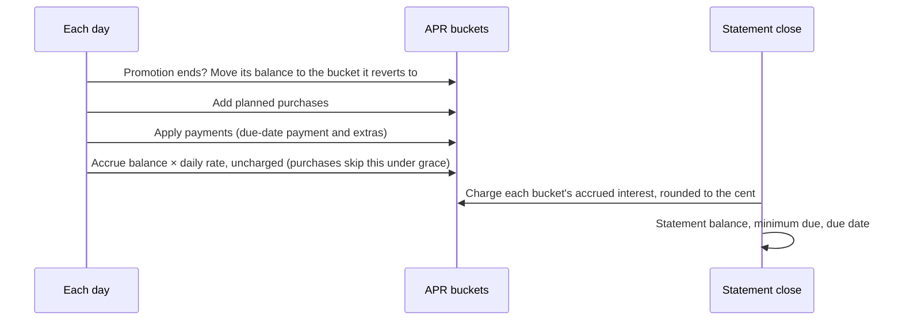

# Credit cards

Code: `src/Mossmint.Engine/Cards/CreditCard.cs`. Tests: `tests/Mossmint.Engine.Tests/Cards/`.

The card model is an **approximation**. Card issuers differ in how they compute average daily balances, order payments and charge trailing interest, and most of that isn't on the statement. Every card result is therefore `Estimated` at best, and its first assumption says so. Statements, entered or imported, are what make it trustworthy.

## The cycle

- **Buckets:** purchase, cash advance, balance transfer, promotional; each with its own rate schedule. A promotional bucket can name the bucket it reverts to when the promotion ends.
- **Interest** accrues daily on each bucket's balance (`Actual365Fixed` by default) and is charged at statement close, rounded to the cent. Charged interest joins the bucket's balance.
- **Statements** close on the card's closing day (clamped to short months). The due date is a number of days after the close, or a day of the month after it.
- **Minimum due:** the larger of a floor and a fraction of the statement balance (plus the cycle's interest, if the card works that way), capped at the balance.
- **Payments:** the planned payment is made on each due date. If it is below the minimum, the minimum is paid instead and a warning says so. Extra payments post on their own dates.
- **Allocation:** the part of a payment up to the minimum goes to the lowest-APR balances first; anything more goes to the highest-APR balances first (the US CARD Act rule). Uncharged interest is paid last.
- **Grace period:** when the previous statement was paid in full by its due date, the purchase bucket accrues no interest for that cycle.
- **Paying it off:** a payment that clears the card also pays the interest accrued since the last statement, which counts as interest charged.
- **Never pays off:** three cycles in a row with no fall in the statement balance, with no promotion ending, rate change, purchase or extra payment ahead, is `NeverPaysOff`. So is running past `MaxCycles` (default 600).

## Not modelled yet

Late fees, annual fees, cash-advance fees, deferred-interest promotions (where the whole promotional balance is charged retroactively), penalty APRs and residual interest that appears on the statement after a payoff. Each one becomes an assumption in the result list when the model learns about it.

## Worked example

18.25% APR (exactly 0.0005 a day), 1,000.00 owed on 10 Sep 2026, closing on the 9th, due 25 days later, 100.00 paid on each due date, minimum the larger of 35.00 and 1% plus interest.

| Close | Interest | Statement | Minimum | Due |
|---|---|---|---|---|
| 9 Oct | 30 days × 1,000.00 × 0.0005 = 15.00 | 1,015.00 | max(35.00, 10.15 + 15.00) = 35.00 | 3 Nov |
| 9 Nov | 24 days × 1,015.00 × 0.0005 + 7 days × 915.00 × 0.0005 = 15.3825 → 15.38 | 930.38 | 35.00 | 4 Dec |
