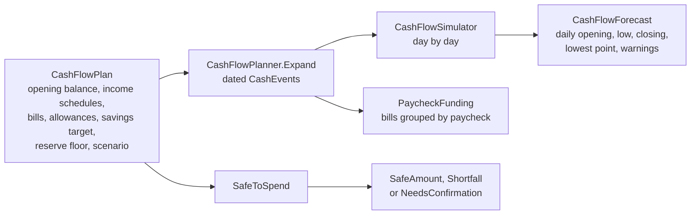
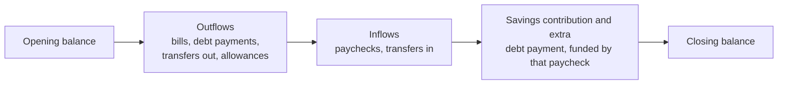

# Cash flow

Code: `src/Mossmint.Engine/CashFlow/`. Tests: `tests/Mossmint.Engine.Tests/CashFlow/` (the synthetic *Juniper* profile).

## From plan to forecast

### Opening balance

The forecast starts from the spending account's latest balance (`RunningBalance`), plus the entries the user has recorded since:

- An entry dated after the balance's date counts.
- An entry dated the same day counts only if it was recorded after the balance was entered. A balance typed in is taken to include everything entered before it.
- An entry dated before the balance never counts; the balance already includes it.
- Void entries and imported or connector entries never count. An imported balance already reflects its own source's transactions.

The opening keeps the balance's provenance and as-of date, so Safe to spend still asks for a fresh confirmed balance. Confirming a new one absorbs the entries before it.

**Mark paid** records one such entry: the bill's expected amount, out of the account it's funded from, dated the day it's marked. The entry names the occurrence it pays (bill and nominal due date), and the planner drops that occurrence, so the payment is never counted twice. For a debt payment only the checking side is recorded: the loan or card projection already applies its scheduled payments after its own balance date. Undo voids the entry; nothing is deleted.

### Events

- **Income:** each paycheck occurrence, at its net pay (or a one-off override for that paycheck).
- **Bills:** each due-date occurrence not already marked paid. Fixed amounts are used as they are; estimates follow the scenario; a bill with no amount is listed as *unvalued* and left out, which drops the forecast's confidence to `NeedsReview`.
- **Savings contribution:** the per-paycheck target, on each payday.
- **Extra debt payments:** a scenario's or plan's extra payment, from the first paycheck of each month ([payoff](payoff.md#how-much-extra-is-safe)).
- **Allowances:** the daily variable-spending allowance for each category, on every day.
- **Stress one-offs:** extra expenses that apply only in the Stress scenario.

Only expenses and allowances count as spending. Debt payments and transfers move money between the user's own accounts, so a card payment never counts twice.

### Order within a day

The day's **low** is the lowest running balance. Paying outflows before the paycheck lands is conservative: it shows the lowest point a day can reach when the deposit arrives later than the bills. The savings contribution and an extra debt payment come after the paycheck because the paycheck pays for them.

The forecast reports, for every day: opening, inflows, outflows, low, closing, whether the low is under the reserve floor or below zero, and the weakest confidence among that day's events. It also reports the lowest point overall, the first day under the floor and the first negative day. Negative cash is reported as it is, never floored at zero.

## Scenarios

Scenarios are assumptions, not probabilities.

| Scenario | Estimated bills and allowances | One-off expenses |
|---|---|---|
| Base | expected amount | none |
| Cautious | midpoint of expected and high | none |
| Stress | high end of the range | included |

Fixed amounts are the same in every scenario.

**Late paychecks** are a separate assumption that combines with any scenario: every paycheck due from today on lands a number of business days late (the app uses 3), and the savings contribution and any extra debt payment move with it. A paycheck pushed past the forecast's last day drops out of it. Paychecks already due before today aren't moved: the confirmed balance already includes them.

## Changing a bill

Code: `ManualEntry.UpdateBill`, `EndBill` and `RemoveBill`. Tests: `tests/Mossmint.Application.Tests/BillEditingTests.cs`.

- **A price change** replaces the amount for every due date the forecast hasn't seen paid; payments already recorded keep their own amounts. The schedule stays as it was.
- **A new day of the month** starts a plain monthly schedule on that day. Skipped months and weekend moves belong to the old day, so they go. This is also how a bill the workbook import split across both paychecks goes back to its real billing day; the other half is ended or removed.
- **A loan or card payment** keeps the debt in step: a loan's regular payment and, when the day moves, its payment dates follow the bill, and a card's due day follows a new day. Payoff dates and the cash forecast then use the same payment.
- **A cancellation** ends the bill from a date: nothing is due on or after it, and its paid history stays. A debt's payment isn't ended or removed while the debt is owed.
- **Removing** is only for a bill that was never paid, such as a typo.

## Paycheck funding

Each obligation is funded by the **latest paycheck on or before its due date**, exactly once. Anything due before the first payday is funded by the cash on hand. Due dates never move.

For each paycheck: available = carry-in + net pay; left before savings = available − obligations; contribution funded = the target, or whatever is left if less; leftover = what remains and carries into the next paycheck (negative when it fell short). A missed contribution is a shortfall against the savings **target**. It is separate from the reserve **floor**, which the daily forecast checks: a plan can fund every contribution and still dip under the floor between paydays, and both are reported.

## Savings goals

A goal is a target, an amount saved (as the user last confirmed it) and an optional date. For a dated goal, the amount needed per paycheck is what's left divided by the paydays from today through that date. Paydays are those of every income schedule, moved off weekends and holidays, each counted once. The amount is rounded **up** to the minor unit (`MidpointRounding.ToPositiveInfinity`), so saving it every payday reaches the target.

Goals don't move money in the forecast. The per-paycheck savings target does, and the Savings page compares the two: when the dated goals together need more per paycheck than the target sets aside, it says by how much. A goal without a date, or with no payday left before it, has no per-paycheck amount.

## Safe to spend

An amount is given only when:

1. the opening balance is `Confirmed` and no older than the freshness window (3 days by default), and
2. every obligation in the horizon has an amount (estimates count at the top of their range).

Otherwise the result is `NeedsConfirmation`, listing exactly what to confirm.

Safe to spend = lowest projected cash through the horizon − reserve floor. Spending that much today keeps every later day at or above the floor. If the lowest point is already under the floor, the result is a `Shortfall` of the difference, not a negative safe amount. The horizon is chosen by the caller; `DayBeforeNextPayday` gives the usual one.
