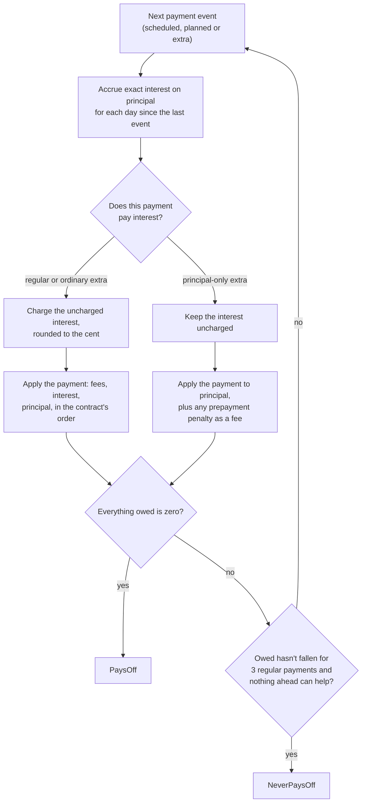

# Loans

Code: `src/Mossmint.Engine/Loans/`. Tests: `tests/Mossmint.Engine.Tests/Loans/`.

Both loan models return a `LoanProjection`: one row per payment, an outcome (`PaysOff`, `NeverPaysOff` or `InsufficientData`), a confidence and the list of assumptions behind it. A projection is not a lender's payoff quote.

## Daily simple interest (`SimpleInterestLoan`)

The reference model for personal and auto loans.

- **Interest** accrues on principal only: `principal × daily rate × days`, split at rate changes. Unpaid interest is carried separately and never compounds.
- **Day count** is per loan: `Actual365Fixed` (rate / 365 every day, leap years included; what the reference spreadsheets do), `Actual360`, or `ActualActual` (rate / 366 for days in a leap year, split at 1 January).
- **Rounding:** interest is kept exact until it is charged, then rounded to the cent (half away from zero by default). It is charged by any payment that pays interest. A principal-only extra payment charges none, so an extra payment never adds a rounding step, and never raises total interest (a property test checks this).
- **Allocation:** fees, then interest, then principal, unless the contract says otherwise. The final payment is capped at what is owed.
- **Planned amounts** replace the regular amount on a scheduled date; zero skips that payment. A planned amount on a date with no scheduled payment becomes an extra payment.
- **Prepayment penalty:** a fraction of principal prepaid before a date, charged as a fee that the next payment covers.
- **Never pays off:** if what is owed hasn't fallen after three consecutive regular payments, and no extra payment or rate change lies ahead, the result is `NeverPaysOff` with the first short payment and the shortfall per payment. More than `MaxPayments` (default 600) regular payments is also `NeverPaysOff`.

Worked example (also a test): 1,000.00 at 12%, Actual/365, 100.00 on the 1st, starting 1 Jan 2027.

| Payment | Days | Interest | Principal | Balance |
|---|---|---|---|---|
| 1 Feb | 31 | 1,000.00 × 0.12 / 365 × 31 = 10.1917… → 10.19 | 89.81 | 910.19 |
| 1 Mar | 28 | 910.19 × 0.12 / 365 × 28 = 8.3787… → 8.38 | 91.62 | 818.57 |
| 1 Apr | 31 | 818.57 × 0.12 / 365 × 31 = 8.3426… → 8.34 | 91.66 | 726.91 |

## Amortizing loans (`AmortizingLoan`)

For loans charged a fixed periodic rate, such as many mortgages.

- **Interest** per payment is `principal × annual rate / periods per year`, whatever the number of days, rounded to the cent. The rate is the one in force on the payment date.
- **Level payment**, when not given, is `P × r / (1 − (1 + r)^−n)` (or `P / n` at 0%), rounded **up** to the cent, and re-derived when the rate changes. The last payment of the term settles whatever per-period rounding left, as lenders do.
- **Extra payments** go to principal and charge no interest of their own.
- A scheduled payment that doesn't exceed the period's interest, with nothing ahead to help, is `NeverPaysOff`.

Worked example: 10,000 at 6% over 12 months gives a level payment of 860.664… → 860.67. The first period charges 50.00 of interest and repays 810.67; the second charges 45.95 (9,189.33 × 0.005 = 45.946…).

## Reconciling with a lender

A projection is compared with lender statements, never forced to match them. A difference becomes a reconciliation item (M3), and the principal is never adjusted silently to absorb it.
