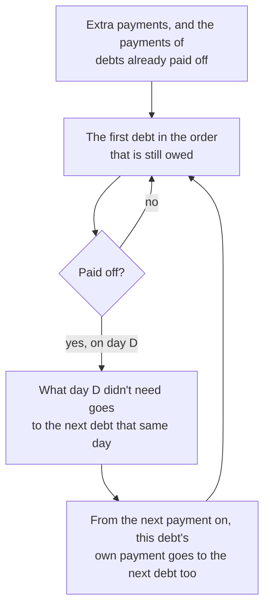

# Paying off several debts

Code: `src/Mossmint.Engine/Payoff/`. Tests: `tests/Mossmint.Engine.Tests/Payoff/`.

`PayoffPlanner` pays debts one at a time on top of their own payments. Each debt is still projected by its own model ([loans](loans.md), [cards](cards.md)); the planner only decides where the extra money goes.

## Orders

- **Avalanche:** the highest rate charged today first; ties go to the smaller balance. For a card, the rate is the highest APR among the buckets that hold a balance, so a balance sitting at a 0% promo rate counts as 0% until the promo ends.
- **Snowball:** the smallest balance (everything owed) first; ties go to the higher rate.
- **Custom:** the user's own order.
- Remaining ties go to the account ID, so the same inputs always give the same order. The order is fixed when the plan starts. It isn't re-sorted as balances change, so "pay this one, then that one" stays the same from month to month.

## Where the money goes

- Every debt keeps its own regular payment until it is paid off.
- **Extras** go to the first debt in the order that is still owed on their date, after that debt's own payment on the same day. On loans they go to principal.
- **Rollover:** once a debt is paid off, its payment (the amount and dates of its debt-payment bill, which is what the cash forecast pays) goes to the first debt still owed. A debt that pays off on its own before its turn frees its payment the same way.
- **The last day:** on the day a debt is paid off, whatever that day's payments didn't need goes on to the next debt the same day. Extras are tracked exactly. The debt's own payment is taken from its bill, so its unused part is exact while the bill matches what the projection paid, and never more than the bill.
- **Today's plan** (`Baseline`) is each debt on its own payments, with nothing moving between them.
- A debt that can't be projected (`InsufficientData`) is never paid extra, and the plan has no debt-free date. A debt that never pays off even with everything sent its way keeps everything from then on.
- **Debt-free date** is the last payoff date, and **interest** the sum of each debt's interest, both only when every debt pays off.

Cross-check (a test): the debt-management skill's worked example (5,000 at 22%, 12,000 at 6%, 3,000 at 15%, with 500 extra a month) gives the same payoff months as its independent month-by-month model, and totals within a cent per debt: avalanche 1,945.91 against 1,945.92, snowball within 0.05 of 2,104.35. The cent comes from rounding each month's interest.
