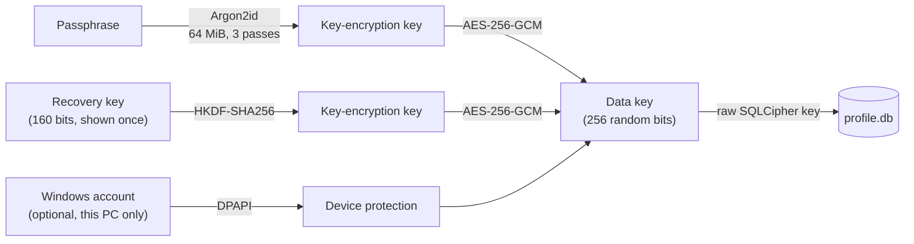
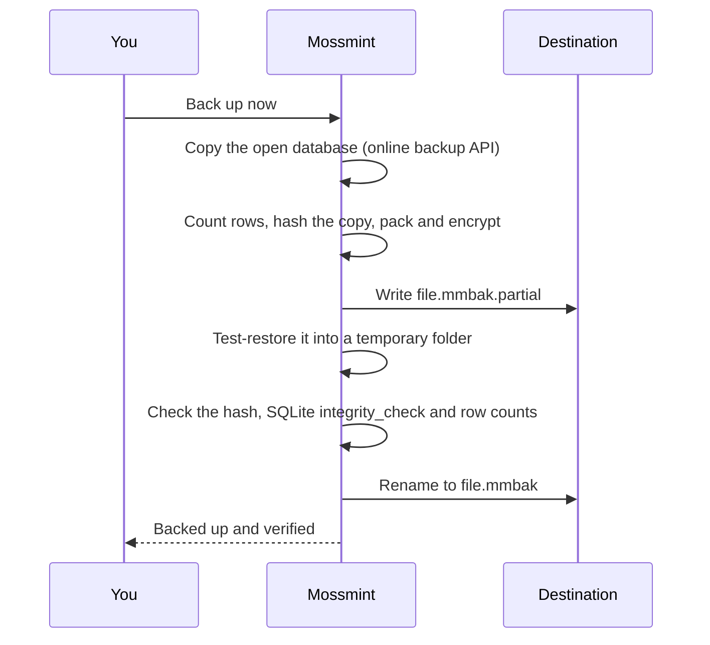

# Profiles, backups and restore

How Mossmint stores a profile, what a backup file contains, and what happens when one is restored. The design decisions are in [ADR-0001](../architecture/ADR-0001-encrypted-local-persistence.md).

## Where a profile lives

```text
%LOCALAPPDATA%\Mossmint\
├── layout.json                  folder layout version
└── Profiles\
    └── <profile-id>\
        ├── profile.json         name and wrapped keys; no secret in clear
        ├── profile.db           SQLCipher v4 database (SQLite3 Multiple Ciphers)
        ├── profile.db-wal       write-ahead log, also encrypted
        ├── snapshots\           encrypted copies taken before schema upgrades and imports
        ├── migrating            only during an upgrade: the snapshot to put back after a crash
        └── backups\             local .mmbak copies, newest five
```

Velopack installs the program to `%LOCALAPPDATA%\Mossmint.Desktop\`, a different folder, so updating or uninstalling never touches a profile. Folders whose names start with a dot (`.creating-…`, `.restore-…`, `.backup-…`, `.verify-…`) are work in progress: they are never shown as profiles and are deleted when the work finishes.

Set `MOSSMINT_DATA_ROOT` to use another folder instead of `%LOCALAPPDATA%\Mossmint`. Tests and the screenshot tool always do this, so they can't touch a real profile. Mossmint refuses a data folder inside its own program folder.

## Keys



- The data key never changes. Changing the passphrase, replacing the recovery key or switching "unlock on this PC" rewrites only `profile.json`, atomically. The old secret stops working at once.
- Losing both the passphrase and the recovery key means the profile can't be opened by anyone.
- Every open checks that the cipher is active and the key works. If either check fails, the profile stays closed; there is no plaintext fallback.
- `Mossmint.Desktop.exe --verify-encryption [report.json]` proves all of this inside the build that is actually installed: it creates a throwaway profile in a temporary folder, checks for plaintext, tries a wrong key, counts SQLite binaries and round-trips a backup. CI runs it against every release build.

## Schema upgrades

Before a profile's database is migrated to a newer schema, an encrypted snapshot goes into `snapshots\`. If a migration fails, the snapshot is put back and the error is shown, so a failed upgrade never leaves a half-migrated profile.

A crash or power cut mid-upgrade skips that error handling, so a small `migrating` file naming the snapshot is written first and deleted once the upgrade finishes. If the next unlock finds it, the snapshot goes back before anything else and the upgrade runs again from a whole file. If that snapshot is missing, the profile is refused unchanged; restore a backup instead.

## The backup file (`.mmbak`)

```text
"MMBACKUP" | container version (u16) | header length (u32) | header (JSON)
chunk 0:  plaintext length (u32) | final flag (u8) | ciphertext | GCM tag (16)
chunk 1:  …
chunk n:  … final flag = 1
```

- **The header** holds only the format version, the wrapped data key for the passphrase and the recovery key, a salt and a nonce. It names no person, account or date of theirs. The "this PC" key is never included.
- **The payload** is a zip of `backup.json` (profile name, row counts, SHA-256 of the database, last schema migration), `profile.json` (without the device key) and a consistent copy of `profile.db` made with SQLite's online backup API, which includes anything still in the WAL. The database inside is itself still encrypted.
- **Encryption:** AES-256-GCM in 1 MiB chunks, with a key derived by HKDF from the data key and a per-backup salt. Each chunk's nonce includes its index, and its associated data is the SHA-256 of the header plus its index and a final-chunk flag. Removing, reordering, truncating, editing or splicing chunks from another backup all fail authentication.

## Making a backup



A backup that doesn't verify is deleted and reported as failed; it is never left looking complete. "Keep a copy on this PC" writes the same kind of file into the profile's `backups\` folder and keeps the newest five. Those copies protect against mistakes, not against losing the PC.

## Restoring

1. Choose the `.mmbak` file and enter the passphrase or recovery key **that were current when the backup was made**. "Unlock on this PC" can't open a backup.
2. Mossmint decrypts into a `.restore-…` folder, then checks the database hash, SQLite's integrity check and the row counts against the backup's manifest.
3. Older backups are migrated to the current schema in that folder.
4. Only then does the folder become a profile. If a profile with the same id already exists, the restore gets a new id: **a restore never replaces anything**.

A wrong secret, a truncated or altered file, a file that isn't a backup, or a backup from a newer Mossmint each fail with their own message and leave nothing behind.

## Moving to a new PC

Install Mossmint, choose *Restore an encrypted backup* on the welcome screen, pick the file and enter the passphrase or recovery key. No account, no network.
