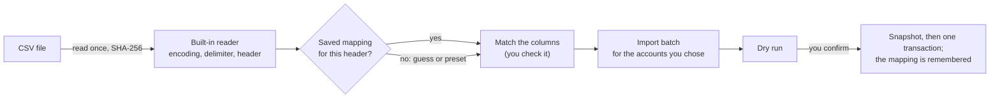

# Bank files

Mossmint imports transactions from a CSV a bank lets you download, or from another app's export. A bank file goes through the same dry run, review queue and one-step commit as a [workbook](workbook-import.md). The original is only read.

## Reading

- **Encoding.** UTF-8 (with or without a byte order mark) and UTF-16 with a byte order mark. Bytes that aren't valid UTF-8 are read as Windows-1252, and the screen says so, because accented names may then look wrong.
- **Delimiter.** Comma, semicolon, tab or `|`: whichever splits the most rows into the same number of fields.
- **Header.** Lines above the header (account details some banks put first) are skipped and counted. A file whose first row already holds a date or an amount has no header, and its columns are numbered.
- **Quoting** follows RFC 4180, with any line ending. Nothing in a cell is ever evaluated.

## Matching the columns

The first time, Mossmint guesses the date, description and amount columns by their names, or by their values when the names don't say. Each choice shows an example from the file. You confirm or change it, and say which account the rows go to: one you have, or a new one. A file with an Account column can send each source account somewhere different, or leave one out.

Exports from **YNAB, Monarch, Actual, Mint and Mossmint** are recognized by their column names, so a reordered or extended header still matches.

When the import is saved, the mapping and the accounts you picked are stored in the profile, keyed by a fingerprint of the header row. The next file with the same header opens already matched.

### Amounts

| How the file writes them | Example |
|---|---|
| One column, spending is negative | `-4.50` |
| One column, spending is positive | `4.50` |
| Separate money out and money in columns | Outflow `4.50`, Inflow empty or `0.00` |
| Positive amounts and a debit/credit column | `4.50`, `debit` |
| As Mossmint exported them | Mossmint's own `transactions.csv` |

Currency symbols, thousands separators, `(4.50)` and `4.50-` are understood; decimal commas are detected. How the amounts are signed in Mossmint is in [financial models](../financial-models/README.md#imported-transactions).

### Dates

Mossmint lists every format that reads all the dates in the column. When `01/02/2026` could be January or February, the screen flags it and shows how the first date reads each way, so the choice is yours. A time after the date is ignored.

## What's left out, what blocks

| Code | Severity | When |
|---|---|---|
| `csv-row-skipped` | Note | A row has no date, like a totals line |
| `csv-date-format` | Blocking | Most rows don't have a date in the chosen format |
| `csv-amount` | Blocking | A dated row's amount can't be read |
| `csv-fractional-amount` | Blocking | An amount has fractions of a cent |
| `csv-void-skipped` | Note | A Mossmint export's void entries |
| `csv-account-skipped` | Note | Rows for a source account you left out |
| `one-source` | Blocking | The account already gets transactions from another source |
| `typed-overlap` | For review | Entries you typed fall on days the file covers |

Until 0.8 can spot the same transaction arriving from two places, each account takes transactions from one source, and entries you typed by hand on the same days are queued so you can void any the file repeats. An imported entry you voided stays void when the file is imported again.

## Reading back Mossmint's export

Mossmint's `transactions.csv` matches the *Mossmint* preset. Its formula escaping (a leading `'` before text starting with `=`, `+`, `-`, `@`, a tab or a carriage return) is dropped, void entries are left out, and pending entries stay pending.
