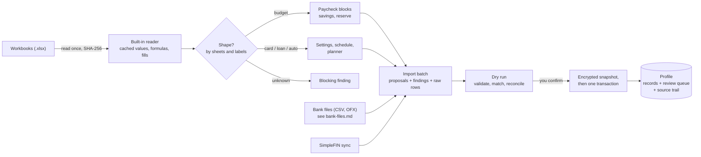

# Workbook import

Mossmint imports a household's existing Excel workbooks into a profile. The import is read-only, previewed first, and saved in one step. Anything it can't settle on its own becomes a review item. Nothing is corrected silently.

## The pipeline



1. **Read.** Each file is read once into memory and hashed. The reader handles only `.xlsx` (zip and XML). It refuses DTDs and caps how much data a file may expand to. It reads the values the spreadsheet app saved and never evaluates a formula, so a stale saved value is caught by reconciliation rather than hidden by recalculation.
2. **Recognize.** A workbook is recognized by its sheets and labels, never by its file name.
3. **Map.** Mapper `workbook/1` turns cells into proposed accounts, balances, debts, bills, income and settings. Each proposal points back to its sheet and cell, and every source row is kept as a raw record.
4. **Dry run.** The planner validates the batch and matches it against earlier imports. It reconciles balances and transactions and lists every change. Nothing is written. The report can be saved.
5. **Commit.** An encrypted snapshot of the profile is taken, then everything is written in one database transaction. If any part fails, nothing lands. The five newest pre-import snapshots are kept.
6. **Verify.** Each original file is hashed again after the import. A match shows the original wasn't touched.

## Known workbook shapes

| Shape | Recognized by | Becomes |
|---|---|---|
| Budget workbook | a `Main Money` sheet of paycheck blocks ("May 15th check") | income, bills, a checking balance, savings target, reserve floor |
| Credit card workbook | `Settings` with a statement closing day, plus `Payment Schedule` | card account, APR, closing day, balances |
| Simple-interest loan workbook | `Settings` with a due day and unpaid accrued interest | loan account, rate, payment and day, principal and accrued interest |
| Auto loan workbook | `Settings` with a baseline date and payments completed | loan account, rate, monthly payment, balances |

The budget mapping:

- **Upcoming blocks become the plan.** A block counts as upcoming when its pay date is today or later. A line repeated over consecutive checks becomes a monthly bill. Gaps become skipped months, and a line that stops before the sheet does gets an end date.
- **Past blocks stay history.** They are kept as raw records.
- **The checking figure comes from the newest past block.** Its left-over figure becomes the starting checking balance, flagged for review.
- **Debt payments link to their debts by name.** A line named like a debt workbook (for example "Fern Card" and *Fern Card Workbook.xlsx*) becomes a debt payment to that debt, so it never counts as spending.

## Findings

| Severity | Meaning |
|---|---|
| Blocking | The import can't be saved: an unreadable or unknown file, two files for one debt, required values missing, mixed currencies |
| For review | Saved to the review queue: something to confirm, or a mismatch to settle |
| Note | Shown in the dry run only |

Review items the workbook mapper raises:

| Code | When |
|---|---|
| `balance-mismatch` | A balance recorded over the workbook's projection differs from what the workbook itself projected for that payment date |
| `due-day-mismatch` | A loan is planned for a day after its due day |
| `card-terms-assumed` | A card's due date and minimum payment rule aren't in the workbook, so Mossmint assumes 21 days after closing and the larger of $40 or 1% plus interest |
| `budget-cash` | The checking balance comes from the budget's left-over arithmetic, not a bank |
| `stale-cache` | A saved value no longer matches what its formula would give (Total Paid sums, daily rates) |
| `google-only-formula` | A value that was used comes from a formula only Google Sheets can calculate |
| `payment-differs` | The budget pays a debt a different amount than the debt workbook's regular payment |
| `budget-note`, `unpaid-lines`, `savings-estimate`, `pay-date-mismatch` | Notes typed in a block, recent unpaid lines, an estimated savings balance, pay dates off the usual rule |

The planner adds `balance-changed`, `stale-balance` (older than 35 days), `edited-both`, `not-in-source` and `removed-at-source`.

## Importing again

- **The same files change nothing.** Proposals match earlier imports by stable keys such as `bill:mid:rent`.
- **Your edits win.** A record you changed in Mossmint keeps your version. If the source changed it too, a review item says so.
- **Nothing is deleted.** A record that disappears from the source stays in the profile and goes to review. The same applies to a transaction a connector reports as removed.
- **A settled item stays settled.** The same finding isn't queued twice, and a dismissed item isn't reopened unless its details change.
- **Previews go stale.** A preview overtaken by another import is refused. Preview again.

## Imported figures and trust

Imported balances and records are labelled *Imported, needs review* until confirmed. Connector figures are labelled *Connector* with their own observation dates. A sync older than three days is flagged as stale, and an older balance never replaces a newer one.

## Command-line import

`tools/Mossmint.ImportTool` imports workbooks into a new profile under a separate data root and writes a verified backup. This is how a profile can be prepared on one PC and restored on another.

```powershell
dotnet run --project tools/Mossmint.ImportTool -- `
  --data-root <folder> --profile <name> `
  --secrets <file> --report <file> --backup <file.mmbak> `
  <budget.xlsx> <debt workbooks...>
```

- **Console output** is names, shapes, hashes and counts only.
- **The passphrase and recovery key** go to `--secrets`, and the dry-run report to `--report`. Keep both private.
- **Delivery:** send the backup and the secrets separately. The recipient restores the backup, then sets a new passphrase and recovery key in Settings.
- **Refusals:** the tool won't overwrite existing files or write to the app's own profiles folder.
