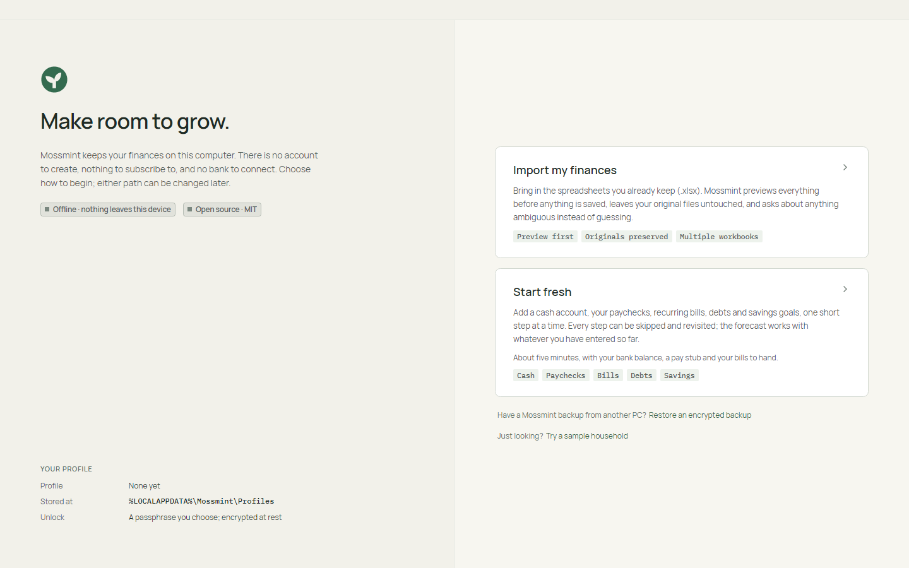
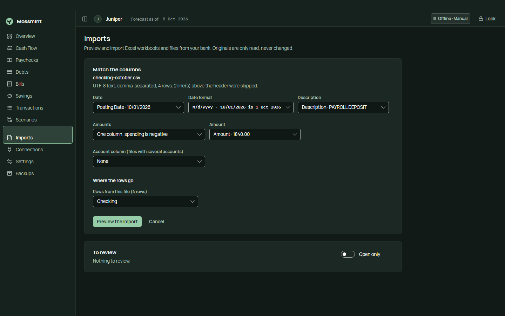
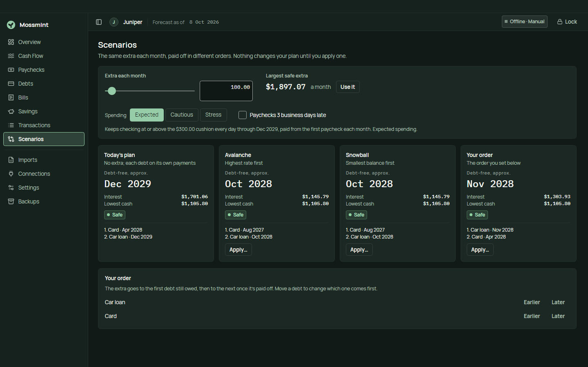
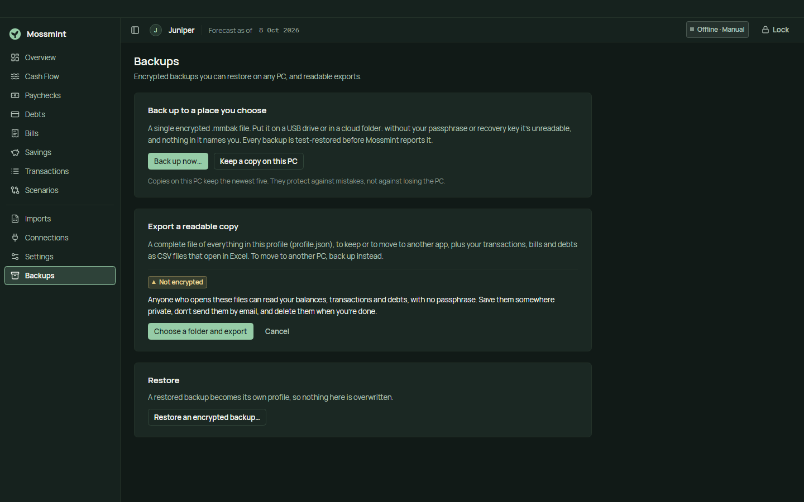

# Using Mossmint

A short guide to the app, page by page. How the numbers are worked out is in [docs/financial-models](../financial-models/README.md).

## Install

Download `Mossmint-Setup.exe` from the [latest release](https://github.com/hazeliscoding/mossmint/releases/latest) and run it. It installs for your Windows account only, with no administrator rights. `SHA256SUMS` lists every file's checksum if you want to check the download.

From 0.6, Mossmint is code-signed with the publisher name *Hazel Granados*. Windows SmartScreen may still say the app is unrecognized until enough people have downloaded it: choose **More info**, check the publisher, then **Run anyway**.

Uninstalling removes the app, never your profiles.

## Getting started

The welcome screen offers three ways in:

- **Import my finances** reads the Excel workbooks you already keep. It shows everything it found before saving anything, never changes your files, and asks about anything unclear. See [workbook import](../operations/workbook-import.md).
- **Start fresh** walks you through a checking account, paychecks, bills, debts and savings, one short step at a time. Every step can be skipped.
- **Restore an encrypted backup** brings a profile from another PC.

**Just looking?** *Try a sample household* opens a separate profile full of made-up numbers, so you can try every page first. It opens on this PC; its passphrase is `sample household` for anywhere else, so don't keep real numbers in it. Delete it any time from **Settings → Delete profile**.

## Your profile

A profile is one encrypted database on this PC. You choose its passphrase, and Mossmint shows a **recovery key** once: store it somewhere safe, because nobody can open the profile without one of the two. **Settings** changes the passphrase, makes a new recovery key, and can let this PC unlock the profile without typing (Windows protects that key for your account). **Lock** closes the profile and clears its key from memory; closing Mossmint does the same.

## Every day

- **Overview** answers the main question: *safe to spend* until the next paycheck, after bills and your cushion, plus the lowest your checking gets before payday.
- **Cash Flow** shows every day ahead as a chart and a table. Try **cautious** or **stress** spending, or paychecks landing 3 business days late, to see how much room you really have.
- **Paychecks** shows which bills each paycheck covers and what's left after them.
- **Bills**: **Mark paid** records a payment (with **Undo** on the row). **Edit** changes a bill's name, price, estimate range or day of the month. A cancelled bill ends from a date and keeps its history; one never paid can be removed. **Add a bill** is at the top.
- **Transactions** holds the money in and out you record with **Add entry**. **Reconcile balance** confirms what the bank says you have.

When a balance is too old or unconfirmed, Mossmint says *needs confirmation* with the reason instead of guessing. Confirm a fresh balance and the answer comes back.

## Bringing in your bank's transactions

**Imports → Choose a file…** reads a CSV or OFX/QFX statement your bank lets you download, or an export from YNAB, Monarch, Actual, Mint or Mossmint itself. A statement names its accounts, so you only choose where each one goes, and the balance it reports counts as confirmed. For a CSV, Mossmint guesses which column holds the date, the description and the amount, showing an example from the file for each, and you choose the account the rows go to. If every date could be month first or day first (01/02/2026), it asks. **Preview the import** shows the dry run; nothing is saved until you choose **Import**. The next file from the same place opens already matched. Details: [bank files](../operations/bank-files.md).

Until 0.8 can spot duplicates, each account takes transactions from one source. If you've also typed entries for the same days, Mossmint asks you to void any the file repeats.

### Connecting with SimpleFIN

If your bank offers no file to download, **Connections** can sync it through [SimpleFIN Bridge](https://bridge.simplefin.org), a separate paid service. You sign in to your bank at SimpleFIN, never in Mossmint, and SimpleFIN gives you a one-time setup token. Paste it into **Connect SimpleFIN…**: Mossmint shows which server the token points to before sending anything, then asks which of your accounts each bank account feeds (or leave one out). The first sync, up to 90 days back, is shown as a dry run; after that, **Sync now** brings new transactions and balances straight in and says what changed. Pending charges wait until they post. A balance from the bank counts as confirmed, so a fresh one clears *needs confirmation*.

Mossmint never syncs on its own. **Disconnect…** deletes the key Mossmint kept and, if you tick the box, the transactions and balances the connection brought in; remove Mossmint's access in SimpleFIN too.

## Debts and scenarios

**Debts** shows each loan and card with its balance, rate, payment and payoff date. **Confirm balance** keeps a debt current. If a payment can't cover the interest, it says *never pays off* rather than inventing a date.

**Scenarios** puts your plan next to avalanche (highest rate first), snowball (smallest balance first) and your own order, all paying the same extra each month. Each column shows when you'd be debt-free, the interest left, and the lowest your checking would get. **Use it** sets the largest extra your cash can take without dipping below your cushion. **Apply…** shows every change before saving it as your plan, and **Undo** stays on the page.

## Savings

**Savings** tracks goals with a target and, if you like, a date, and shows how much each paycheck would need to put aside to get there.

## Backups, export and moving PCs

- **Backups → Back up now…** writes one encrypted `.mmbak` file to a place you choose. It's unreadable without your passphrase or recovery key, and every backup is test-restored before Mossmint reports it. **Keep a copy on this PC** keeps the newest five locally.
- **Export…** writes a readable copy: a complete `profile.json`, plus transactions, bills and debts as CSV files for Excel. These files are **not encrypted**, so Mossmint warns first. Keep them private and delete them when you're done. An export can't be restored; only a backup can.
- **Moving to a new PC:** install Mossmint there, choose **Restore an encrypted backup** and enter your passphrase or recovery key.

## Updates

**Settings → Updates → Check now** asks GitHub for the latest release. Turn on *Checks once a day while Mossmint is open* and a quiet strip appears at the top of the app when a new version is out: **Download** gets it, **Not now** hides it until the next one. Downloading and restarting are always your call, and Windows Update never touches Mossmint. Back up before a big update; the first unlock after an update upgrades the profile and keeps a copy from just before.

## Privacy

Everything stays on this PC. Mossmint makes no network calls unless you check for updates, sends no telemetry, and never asks for a bank login. Details: [PRIVACY.md](../../PRIVACY.md).
